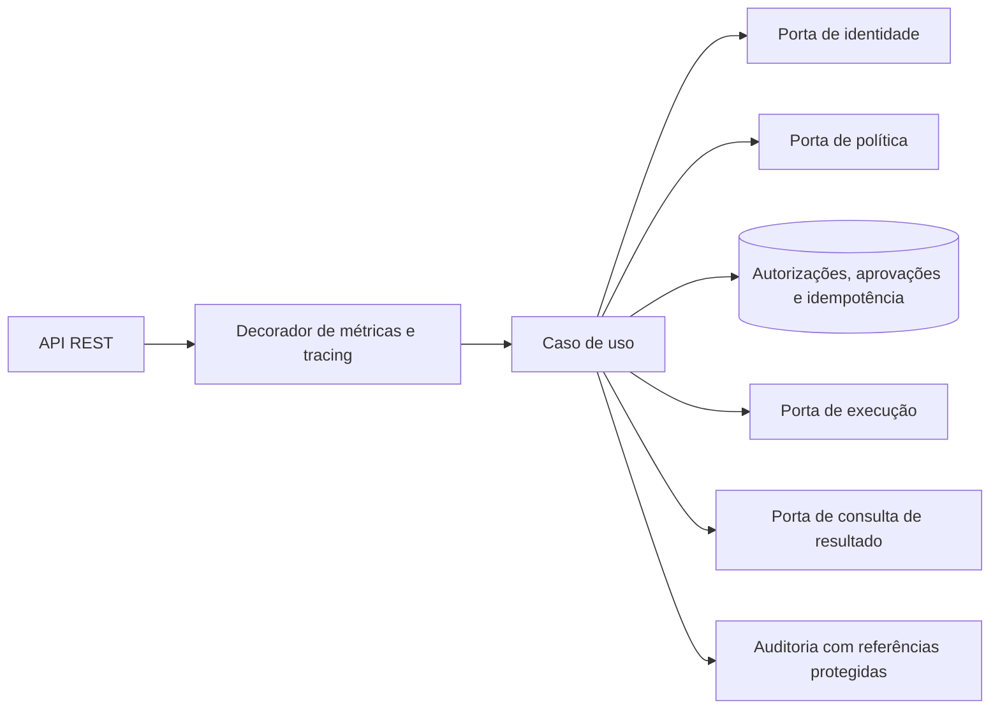

# Arquitetura e fluxo

O módulo segue arquitetura hexagonal: domínio sem Spring, portas de aplicação e adaptadores
para HTTP, persistência, auditoria e provedores externos. ArchUnit verifica esses limites.

## Decisões independentes

1. Verificar força e recência da autenticação.
2. Avaliar autorização de negócio para sujeito, representante e operação.
3. Conferir a aprovação humana persistida, ligada à intenção exata.

MFA e autenticação do representante não substituem consentimento do titular. Atribuição,
tipo, operação, versão e digest devem coincidir com a autorização aprovada. A codificação
`mfa-intent-v2` preserva tipos, nulos, espaços e ordem de listas, ordenando objetos recursivamente.
Aprovações geradas pelo algoritmo anterior exigem nova aprovação.

## Execução e recuperação

Uma transação curta valida a evidência, reserva a chave, consome a aprovação e grava
`EXECUTING`. Ela termina antes de chamar o serviço de negócio. Outra transação grava o
resultado. A requisição é identificada por hash do escopo/chave e fingerprint canônico.

Resultados terminais são reproduzidos sem nova execução. Conteúdo alterado com a mesma
chave e solicitações ainda ativas retornam conflito. Resultado incerto vira `OUTCOME_UNKNOWN`;
retry consulta o sistema proprietário. Um token de propriedade impede que respostas antigas
sobrescrevam uma reconciliação. O vencimento da lease ou retenção não autoriza reenvio.

## Persistência e limites

- Flyway V1: autorizações, aprovações, idempotência e auditoria.
- V2: atribuição do representante, aprovador e confirmação humana.
- V3: autorização vinculada à execução, proprietário e lease.
- Padrão local: H2 em memória. Adaptadores JDBC também possuem caminho PostgreSQL ainda
  pendente de execução em Testcontainers nesta máquina.
- Lockout: estado em memória, isolado por titular/tipo/operação.
- Auditoria: transação independente; referências HMAC e categorias limitadas, sem texto livre.

## Integrações pendentes

O backend não inclui a interface humana, emissão real de consentimento, validação de bearer
ou adaptadores reais de identidade/política/negócio. O adaptador local de consulta retorna
resultado incerto por padrão. A implantação precisa definir banco, chave de auditoria,
armazenamento de lockout e configuração operacional.

[Jornada funcional](../journey/post-mfa-stepup-autorizacao.md) ·
[Modelo de dados](../../specs/001-step-up-transaction-approval/data-model.md) ·
[Auditoria e pendências](../../specs/001-step-up-transaction-approval/analyze.md)
