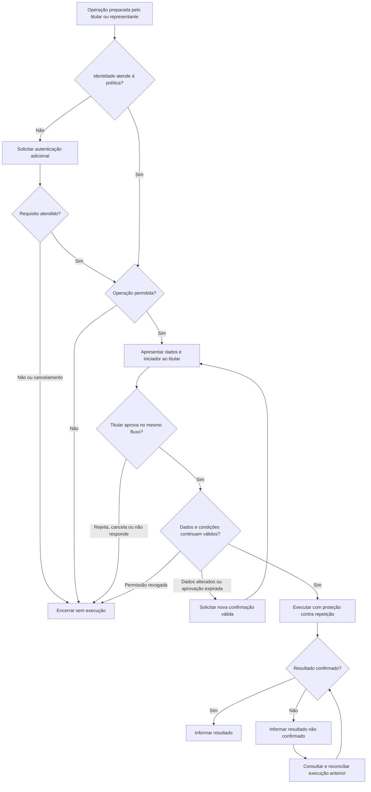

# Jornada do usuário — Confirmar uma operação sensível

Data: 24/10/2026. Jornada alvo derivada da especificação vigente e relacionada ao
[modelo de negócio](../business/modelo-de-negocio.md). As interações e mensagens abaixo
são propostas para a experiência; a interface humana ainda não está implementada.

## 1. Contexto Estratégico & Objetivo de Negócio

**Persona principal:** titular ou responsável por um recurso que deseja realizar uma
operação sensível com clareza sobre o que está aprovando e sobre seu resultado.
**Persona de apoio:** representante humano ou agente de IA que prepara a solicitação.

**Exemplo ilustrativo:** João deseja transferir R$ 50.000,00 para Maria. O valor não
define um limite real do produto; a exigência de verificação depende da política.
A mesma jornada aplica-se a operações não financeiras, com seus respectivos dados materiais.

**Necessidade:** “Quero confirmar exatamente a operação que pretendo realizar, saber quem
a preparou e receber um resultado confiável, mesmo quando a comunicação falhar.”

Pré-condições: operação com dados definidos, política aplicável, identidade verificável
e acesso do titular a um canal confiável. Na delegação, a atribuição também precisa ser
verificável. Força de autenticação, validade da aprovação e limites de tentativas dependem
da política; nenhum prazo numérico é assumido nesta jornada.

## 2. Serviço de Negócio na Jornada

O serviço **Autorizar operações sensíveis** transforma a intenção em uma decisão
verificável. O domínio responsável executa o efeito de negócio após as verificações.
A sequência abaixo descreve a experiência proposta, não uma ordem obrigatória de telas.

| Etapa | Ação do titular | Resposta esperada do serviço/canal | Necessidade e possível fricção | Evidência de sucesso |
|---|---|---|---|---|
| 1. Preparar | Informa a operação ou recebe a preparação feita pelo representante. | Identifica titular, iniciador e dados materiais. | Compreender o que será feito e em nome de quem. | Solicitação atribuída sem ambiguidade. |
| 2. Verificar identidade | Realiza autenticação adicional quando solicitada. | Explica a necessidade e verifica força e atualidade; não repete o desafio indefinidamente. | Entender a interrupção e conseguir cancelar. | Requisito atendido ou encerramento sem execução. |
| 3. Avaliar permissão | Aguarda a decisão de autorização. | Verifica se a ação é permitida; autenticação válida não supera uma negativa. | Saber por que não pode prosseguir sem exposição de informações sensíveis. | Permissão válida ou negativa clara. |
| 4. Revisar | Confere dados e identidade de quem preparou a solicitação. | Mostra origem, destinatário, valor e moeda quando aplicáveis, além dos demais dados materiais. | Reconhecer erros antes de consentir. | Titular consegue explicar o efeito que aprovará. |
| 5. Decidir | Aprova os dados apresentados, rejeita ou cancela. | Vincula a decisão à operação exata; se não houver resposta no fluxo, cancela. | Ter controle e liberdade para recusar. | Consentimento específico ou encerramento sem execução. |
| 6. Executar | Aguarda a conclusão sem recriar a solicitação. | Revalida as condições necessárias e impede uso repetido da aprovação. | Evitar incerteza e efeito duplicado. | Resultado da operação ou indicação explícita de resultado não confirmado. |
| 7. Obter resultado | Lê a confirmação ou retoma a consulta após interrupção. | Recupera o resultado original; se incerto, verifica a execução anterior. | Saber se houve efeito e qual é o próximo passo. | Resultado esclarecido sem nova execução indevida. |

### Fluxo de decisão

O retorno à confirmação exige as verificações ainda aplicáveis. A reconciliação pode
permanecer sem resultado confirmado; não representa repetição automática da execução.

## 3. Ofertas de Serviço e Variações da Experiência

As ofertas **Confirmação de operação pelo titular** e **Confirmação de operação preparada
por representante** compartilham o serviço e a jornada. Na segunda, o titular deve ver
quem iniciou a solicitação e em nome de quem. O representante não pode substituir a
aprovação humana exigida. Se o titular estiver indisponível, a solicitação é cancelada;
uma futura intenção requer um novo fluxo, sem fila de aprovação posterior.

O consumo humano é proposto para aplicativo ou portal confiável, ainda a definir.
O backend atual oferece integração local. SLA, canal definitivo e modelo de custeio
estão pendentes conforme o modelo de negócio.

### Exceções e mensagens propostas

| Situação | Consequência e próximo passo | Mensagem sugerida |
|---|---|---|
| Autenticação cancelada ou insuficiente | Encerrar sem executar; permitir nova tentativa conforme a política. | “A verificação não foi concluída. A operação não foi executada.” |
| Permissão negada | Encerrar sem executar; não oferecer autenticação como forma de superar a decisão. | “Esta operação não foi autorizada.” |
| Titular rejeita | Encerrar sem executar e preservar a decisão atribuída ao titular. | “Você rejeitou a operação. Ela não foi executada.” |
| Titular cancela ou fica indisponível | Cancelar sem execução e sem aprovação posterior. | “A solicitação foi cancelada sem execução.” |
| Dados alterados ou aprovação expirada | Recusar a aprovação anterior; apresentar os dados e obter nova aprovação válida. | “Revise os dados e confirme novamente antes de prosseguir.” |
| Representante ou titular não verificável | Recusar a solicitação sem tratá-la como iniciativa direta do titular. | “Não foi possível validar quem iniciou esta solicitação.” |
| Limite de falhas atingido | Limitar temporariamente as tentativas da operação; informar quando tentar novamente se disponível. | “As tentativas desta operação estão temporariamente limitadas.” |
| Mesma solicitação repetida após conclusão | Retornar o resultado original sem produzir outro efeito. | “Este é o resultado da operação já processada.” |
| Operação em execução | Informar que ainda não há resultado final; preservar a referência original. | “A operação está em processamento. Acompanhe esta solicitação.” |
| Comunicação interrompida e efeito desconhecido | Verificar o resultado anterior antes de qualquer nova execução; encaminhar ao suporte quando necessário. | “O resultado ainda não foi confirmado. Acompanhe esta solicitação antes de iniciar outra.” |

“Resultado não confirmado” significa que a execução pode ter ocorrido. Esse estado não
é aprovação pendente, cancelamento nem confirmação de sucesso. As mensagens finais devem
refletir o estado efetivamente conhecido.

### Critérios de aceite da experiência

| Cenário | Resultado observável | Rastreabilidade |
|---|---|---|
| Titular confirma uma operação válida | Os dados revisados correspondem ao efeito executado; aprovação consumida uma vez. | US1; FR-004–FR-007 |
| Dados mudam após a confirmação | A aprovação anterior é recusada e há nova revisão. | US1; FR-006 |
| Solicitação delegada | Titular identifica representante e operação; agente não aprova em seu lugar. | US2; FR-009–FR-010 |
| Titular indisponível | Solicitação cancelada sem execução nem espera por aprovação posterior. | US2; FR-008 |
| Interrupção, repetição ou concorrência | Resultado original recuperado ou incerteza informada sem novo efeito indevido. | US3; FR-011–FR-012 |
| Falhas repetidas | Restrição temporária da operação sem bloqueio automático da conta inteira. | FR-015 |
| Consulta de evidências | Decisões e envolvidos são rastreáveis sem exposição de credenciais. | FR-013–FR-014 |

## 4. Relatório de Obstáculos e Riscos (Obstacle Report)

| Obstáculo | Ação recomendada para validar a jornada |
|---|---|
| Não há interface humana implementada | Prototipar e validar compreensão dos dados, atribuição, recusa e resultado incerto com usuários. |
| Integrações externas são simuladas | Demonstrar a jornada completa com identidade, política, emissão de consentimento e executor reais. |
| Resultado incerto pode gerar novas operações manuais | Manter referência e acompanhamento da solicitação; definir encaminhamento, responsável e prazo de suporte. |
| SLA e parâmetros ainda não definidos | Acordar prazos, validade, limites de tentativas e mensagens antes da disponibilização. |
| Artigo de origem contém alternativas fora do escopo atual | Usar a especificação vigente como referência para o fluxo sem aprovação posterior. |

Indicadores propostos para a validação: conclusão por etapa, abandono, compreensão dos
dados e do iniciador, frequência de repetição e tempo para esclarecer resultado incerto.
Não há pesquisa de usuários ou métricas de uso real anexadas; necessidades e fricções
descritas devem ser validadas, não tratadas como achados de pesquisa.

Fontes: [especificação funcional](../../specs/001-step-up-transaction-approval/spec.md),
[limites da implementação](../architecture/README.md) e
[pendências e evidências](../../specs/001-step-up-transaction-approval/analyze.md).
