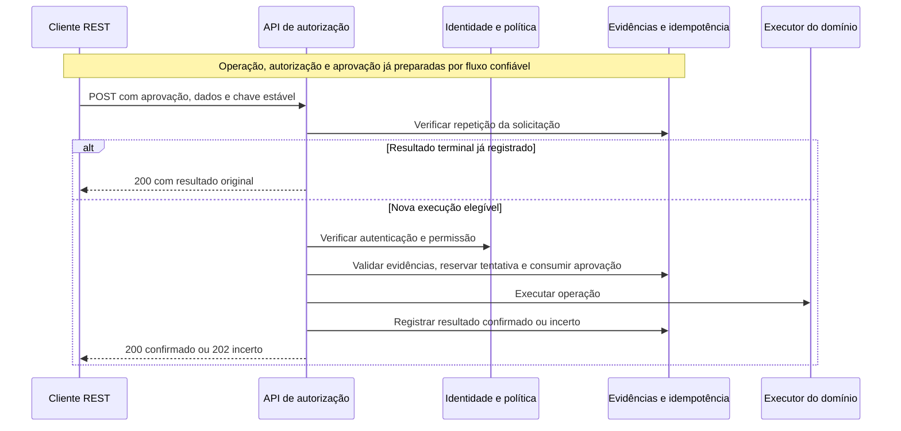

# Jornada técnica — Usar a API com um cliente REST

Este roteiro descreve a API implementada e pode ser seguido no Postman, Insomnia ou em
um cliente compatível com arquivos `.http`. Use o [arquivo de requisições](../../application/requests/operation-authorizations.http)
como ponto de partida. O [contrato OpenAPI](../../specs/001-step-up-transaction-approval/contracts/operation-authorization.openapi.yaml)
também pode ser importado no cliente, ajustando o servidor para `http://localhost:8080`.

## 1. Iniciar e verificar a aplicação

Na raiz do repositório, com JDK 21 ou superior e Maven instalados:

```powershell
cd application
mvn spring-boot:run
```

Envie no cliente REST:

```http
GET http://localhost:8080/actuator/health
Accept: application/json
```

A aplicação saudável responde `200`, com `status` igual a `UP`.
O banco padrão é H2 em memória: encerrar o processo perde os registros locais.

## 2. Preparar as evidências antes da chamada REST

O endpoint disponível é `POST /api/v1/operation-authorizations`. Ele valida evidências
persistidas e solicita a execução; não cria uma aprovação a partir do JSON enviado.

| Pré-requisito | O que precisa estar disponível | Como está no projeto |
|---|---|---|
| Operação | Identificador, tipo, versão e dados materiais que o titular revisou. | Integração com o domínio real pendente; não há endpoint de criação neste backend. |
| Autorização persistida | Registro compatível com a operação, titular, representante quando houver e intenção aprovada. | Os testes preparam os registros em ambiente controlado. |
| Aprovação persistida | Referência válida, não consumida, com autoria humana e vínculo aos dados exatos. | Emissão confiável de consentimento e interface humana ainda externas ao backend. |
| Identidade e política | Evidência de autenticação e decisão de permissão. | Adaptadores locais simulam autenticação recente e política permissiva. |
| Execução e consulta | Aplicação do efeito e esclarecimento do resultado. | Execução local simulada; consulta local retorna resultado incerto por padrão. |

Obtenha os identificadores e os dados do fluxo confiável ou de uma preparação controlada
de desenvolvimento. Não invente um `approvalId`: ele não cria nem comprova consentimento.
Também não calcule o vínculo da intenção manualmente com uma simples concatenação de
campos; a implementação usa canonicalização tipada.

**Limite do roteiro:** iniciar uma instalação vazia permite verificar saúde e respostas de
validação, mas não executar o caminho de sucesso apenas pelo cliente REST. Não há endpoints
de login, emissão de aprovação, preparação de fixture ou consulta `GET` da autorização.
O exemplo abaixo depende dos registros correspondentes já preparados.

Para observar o fluxo completo automatizado em um servidor HTTP real com banco e
adaptadores controlados, execute em `application`:

```powershell
mvn '-Dtest=AuthorizationAcceptanceTest' test
```

Esse teste cobre execução, replay, alteração de conteúdo, step-up, negativa de política,
limitação temporária e reconciliação. Ele prepara dados no próprio contexto do teste;
não popula a aplicação iniciada separadamente em `localhost:8080`.

## 3. Configurar a requisição no cliente

Defina `baseUrl = http://localhost:8080`. Para cada nova intenção de execução, gere uma
chave aleatória e guarde-a com o corpo original. Em PowerShell, gere um UUID com:

```powershell
[guid]::NewGuid().ToString()
```

Cole o valor no cabeçalho `Idempotency-Key`. A chave deve ter de 16 a 255 caracteres ASCII
visíveis, sem espaços. **Não configure geração dinâmica a cada envio:** retries e
reconciliação precisam reutilizar a chave original.

| Campo/cabeçalho | Orientação |
|---|---|
| `Content-Type` | `application/json`. |
| `Accept` | `application/json, application/problem+json`. |
| `Idempotency-Key` | Obrigatório; preservar na repetição da mesma solicitação. |
| `X-Correlation-Id` | Opcional; referência para correlação, independente da chave de idempotência. |
| `subjectId` | Titular compatível com a autorização e a aprovação persistidas. |
| `actorId` / `delegated` | Na operação direta, omitir `actorId` e usar `delegated: false`; na delegada, informar o representante e `true`. |
| `operationId` / `operationType` | Operação existente e sua classificação. |
| `intentVersion` | Versão exata revisada pelo titular, inteiro maior ou igual a zero. |
| `materialData` | Objeto não vazio com os dados materiais aprovados, preservando tipos e valores. |
| `approvalId` | Referência opaca da aprovação confiável persistida. |

O contrato prevê `Authorization: Bearer <access_token>` para a integração autenticada.
O backend local ainda não valida bearer nem vincula o payload a um principal real;
adicionar esse cabeçalho localmente não implementa autenticação. No ambiente integrado,
use o token emitido pelo provedor e as regras de identidade efetivamente configuradas.

## 4. Enviar a solicitação de execução

Exemplo de operação direta. Os valores são ilustrativos e precisam corresponder aos
registros preparados, inclusive os tipos JSON de `materialData`:

```http
POST http://localhost:8080/api/v1/operation-authorizations
Content-Type: application/json
Accept: application/json, application/problem+json
Idempotency-Key: 1ad42154-090f-4674-87cd-67a9be2523ce
X-Correlation-Id: rest-demo-001

{
  "subjectId": "owner",
  "delegated": false,
  "operationId": "op",
  "operationType": "TRANSFER",
  "intentVersion": 1,
  "materialData": {
    "amount": "10",
    "currency": "BRL"
  },
  "approvalId": "approval"
}
```

O exemplo mínimo não define todos os dados de uma transferência real. Origem, destinatário
e quaisquer outros dados materiais exigidos pelo domínio também devem estar presentes
na intenção apresentada, aprovada e enviada.

Para uma operação delegada, use `"delegated": true` e `"actorId": "agent"`, com
registros previamente preparados para essa mesma atribuição. Adicionar `actorId` ao
exemplo direto não transforma sua aprovação em uma aprovação delegada válida.



O diagrama resume o fluxo de sucesso; validações recusadas interrompem a execução.

## 5. Interpretar o resultado

Resposta de sucesso ilustrativa; identificadores, referência, horário e mensagem variam:

```json
{
  "authorizationId": "authorization-preparada",
  "operationId": "op",
  "state": "EXECUTED",
  "executed": true,
  "outcomeUnknown": false,
  "businessResultRef": "default_tx_ref_op",
  "executedAt": "2026-10-24T15:00:00Z",
  "message": "mensagem informativa",
  "subjectId": "owner",
  "actorId": null
}
```

`200` significa resultado confirmado, não necessariamente sucesso de negócio:

| HTTP / estado | Interpretação | Ação do cliente |
|---|---|---|
| `200` / `EXECUTED` | Execução confirmada. | Guardar o resultado e a referência. |
| `200` / `EXECUTION_FAILED` | Falha de negócio confirmada. | Tratar a falha; reenviar a mesma solicitação reproduz esse resultado. |
| `202` / `OUTCOME_UNKNOWN` | A execução pode ter ocorrido; resultado ainda não confirmado. | Preservar corpo e chave; repetir para consultar/reconciliar a execução anterior. |

Não interprete `executed: false` isoladamente como garantia de ausência de efeito se
`outcomeUnknown` for `true`. `202` não é espera por aprovação humana.

## 6. Repetir ou recuperar após interrupção

Reenvie o **mesmo POST com a mesma chave e o mesmo corpo**. Não há um endpoint `GET`
separado para consulta implementado neste backend.

1. Após `200`, a repetição devolve o resultado terminal armazenado sem nova execução.
2. Após `202`, a repetição verifica/reconcilia o resultado anterior, sem reenviar a execução
   ao domínio. O adaptador local de consulta continuará incerto por padrão.
3. Em timeout, perda de conexão ou `500`, preserve a solicitação original: o cliente não
   deve assumir que o efeito não ocorreu. Retome com a mesma chave e corpo.
4. Se receber `409` por execução ou reconciliação ativa, aguarde antes de repetir; não
   faça polling contínuo. A política de intervalos e o prazo de suporte ainda precisam
   de definição operacional.

O vencimento de uma reserva de processamento não autoriza uma segunda execução. Tampouco
troque a chave para contornar um conflito ou reutilizar uma aprovação consumida.

## 7. Tratar recusas e validar cenários

| Resposta | Causa ou distinção necessária | Próximo passo |
|---|---|---|
| `400` | Payload/cabeçalho inválido, evidência inexistente, incompatível, expirada ou consumida. | Ler Problem Details e conferir a preparação; obter nova aprovação quando necessário. |
| `401` | Autenticação não atende à força/atualidade exigida. | Ler `WWW-Authenticate`, concluir step-up no provedor integrado e repetir; não inventar um endpoint de autenticação nesta API. |
| `403` | Política negou a operação. | Encerrar ou seguir o tratamento de negócio; novo MFA não supera a negativa. |
| `409` | Mesma chave com conteúdo diferente **ou** processamento ainda ativo. | Para conteúdo diferente, corrigir o uso da chave; para processamento ativo, aguardar e repetir a solicitação original. |
| `429` | Limite temporário de tentativas da operação. | Respeitar `Retry-After`; não bloquear automaticamente a conta inteira. |
| `500` | Falha interna com resposta genérica. | Preservar chave/corpo, recuperar com segurança e usar a referência de correlação no diagnóstico. |

Os erros usam `application/problem+json`; considere `status`, `title` e `detail` quando
presentes. Não dependa do texto exato da mensagem para decidir o comportamento do cliente.

Na aplicação vazia, envie uma requisição sem `Idempotency-Key` para observar `400`.
Para validar sucesso seguido de replay, use uma fixture válida e envie duas vezes o
mesmo POST. Depois do resultado terminal, mudar `"amount": "10"` para `"amount": "20"`
mantendo a chave deve produzir `409`. Usar uma nova chave com a aprovação já consumida
deve ser recusado com `400`.

Para validar `401`, `403`, `202` e reconciliação confirmada, é necessário controlar os
adaptadores ou usar os testes de aceitação: o JSON enviado ao endpoint não configura
identidade, política ou resultado do executor. Rejeição e cancelamento humanos encerram
o fluxo anterior sem solicitar execução; não existe endpoint público de recusa neste backend.

Referências: [execução e configuração](../../application/README.md),
[jornada do usuário](jornada-do-usuario.md),
[arquitetura](../architecture/README.md) e
[limites e pendências](../../specs/001-step-up-transaction-approval/analyze.md).
