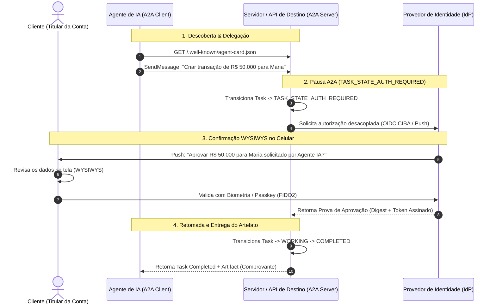

# O Usuário Confirmou o MFA. Mas o Que Ele Autorizou?

*Uma análise sobre como conectar Step-Up Authentication (RFC 9470), Aprovação Transacional e Arquiteturas Multi-Agente (A2A) sem criar brechas de segurança.*

---

## 1. O Cenário Concreto e a Provocação Inicial

Imagine uma operação bancária cotidiana: **João**, logado em seu aplicativo móvel, solicita uma transferência de **R$ 50.000,00** para **Maria**. 

Como a operação ultrapassa o limite de risco padrão, o sistema interrompe o fluxo e solicita uma verificação de segundo fator (MFA) via Passkey ou biometria. João toca no sensor, o aplicativo confirma a leitura, o servidor aceita a credencial e a transferência é concluída.

À primeira vista, o fluxo parece perfeito. No entanto, do ponto de vista de arquitetura de segurança, uma pergunta fundamental precisa ser feita:

> **O segundo fator provou que João é quem diz ser. Mas qual evidência técnica e imutável liga essa verificação especificamente ao valor de R$ 50.000,00 e à conta de Maria?**

Se a resposta da sua arquitetura for apenas *"o token de acesso possui uma claim de MFA válida"*, existe uma vulnerabilidade conceitual. Considere um cenário de falha ou manipulação (*Time-of-Check to Time-of-Use* / TOCTOU): enquanto João visualiza a tela do autenticador, uma requisição paralela (ou um malware em segundo plano, ou um agente de IA malicioso) altera o destinatário da transação de Maria para uma conta fraudulenta. Se o backend verificar apenas que *"o MFA do usuário X foi concluído com sucesso nos últimos 5 minutos"*, o pagamento sairá para o conta errada — com uma autenticação tecnicamente válida.

---

## 2. A Tripartição do Controle de Acesso

Para evitar esse diagnóstico equivocado, é indispensável separar a segurança da operação em **três decisões independentes**:

| Camada de Controle | Pergunta que responde | Mecanismos e Padrões Aplicados |
| :--- | :--- | :--- |
| **1. Autenticação & Step-Up** | A identidade foi verificada com a força e a atualidade exigidas para o contexto? | RFC 9470 (OAuth Step-Up), OIDC `acr`, `auth_time`, `max_age`, FIDO2. |
| **2. Autorização (IAM / RBAC)** | Esta identidade possui permissão política para realizar essa ação sobre este recurso? | Políticas de acesso, escopos OAuth, RBAC/ABAC, contexto de tenant. |
| **3. Aprovação Transacional** | O usuário revisou e confirmou **estes dados específicos e imutáveis** da operação? | OWASP WYSIWYS, Rich Authorization Requests (RFC 9396), Digest de Transação, Idempotência. |

O **Step-Up Authentication (MFA)** atende à primeira decisão: ele eleva o grau de confiança na sessão e garante a recência da presença humana. Ele **não substitui** a aprovação transacional dos dados de negócio.

---

## 3. O Protocolo RFC 9470: Como Funciona o Step-Up Challenge

Quando uma API (Servidor de Recursos) identifica que a requisição corrente exige maior nível de segurança, ela rejeita o acesso e retorna uma resposta **HTTP 401 Unauthorized** padronizada pelo protocolo **RFC 9470**:

```http
HTTP/1.1 401 Unauthorized
WWW-Authenticate: Bearer error="insufficient_user_authentication",
  error_description="Esta operacao exige autenticacao recente e contexto elevado",
  acr_values="urn:cognito:loa:3",
  max_age="300"
```

### Recência (`max_age`) vs. Força (`acr_values`)
A RFC 9470 introduz dois parâmetros complementares que expressam requisitos distintos:
- **`max_age` (Recência)**: Define a janela máxima permitida (em segundos) desde a última autenticação ativa do usuário (`auth_time`). No OpenID Connect Core, o suporte ao `max_age` é um requisito estrito (**`MUST`**). Importante: **a renovação de tokens via *Refresh Token* NÃO altera o `auth_time`**, garantindo que sessões mantidas em segundo plano por horas continuem exigindo nova presença humana quando o tempo expira.
- **`acr_values` (Força/Contexto)**: Solicita uma classe de contexto de autenticação (ex.: `urn:cognito:loa:3`). A RFC 9470 estabelece que o Servidor de Autorização **`SHOULD`** tratar o `acr` solicitado como necessário; caso o usuário não consiga satisfazer o nível (ex.: cancelar a biometria), a requisição deve falhar com o erro `unmet_authentication_requirements` para evitar que a aplicação entre em *loop* infinito.

### O Papel do Access Token
Um *access token* emitido após o Step-Up atesta que a sessão do usuário possui a força (`acr`) e a recência (`auth_time`) adequadas. Esse token pode ser utilizado para invocar APIs do sistema enquanto estiver dentro da sua janela de validade. No entanto, o *access token* em si **não é a prova de aprovação da transação R$ 50.000 para Maria** — essa aprovação de negócio precisa de um escopo e controle próprios.

---

## 4. Diretrizes Normativas: OWASP, NIST e Provedores de Nuvem

### O Princípio OWASP WYSIWYS (*What You See Is What You Sign*)
A **OWASP Transaction Authorization Cheat Sheet** enfatiza que o processo de aprovação deve impedir a manipulação de dados entre a apresentação ao usuário e a execução no servidor. 

A interface de confirmação deve apresentar explicitamente os dados sensíveis e imutáveis da operação (*valor, moeda, conta de origem e destinatário*) no próprio dispositivo confiável do usuário antes da captura da biometria ou Passkey. Se qualquer parâmetro for alterado no backend, a aprovação é invalidadade e exige novo consentimento.

### Alinhamento com o NIST SP 800-63B e Autenticadores
- **Passkeys vs. Níveis de Garantia (AAL)**: Passkeys sincronizadas em nuvem (*cloud-synced passkeys*) cumprem os requisitos para o **NIST AAL2**. O nível **NIST AAL3** exige obrigatoriamente um autenticador baseado em hardware com chave privada não exportável (ex.: FIDO2 Security Keys físicas, módulos TPM dedicados) e resistência total à personificação de verificador.
- **Amazon Cognito**: O nível `urn:cognito:loa:3` do Cognito aceita combinações de senha com SMS/e-mail OTP ou Passkeys. Portanto, o nome da classe `loa:3` **não garante isoladamente um método resistente a phishing por padrão**, cabendo à aplicação inspecionar o vetor `amr` (`swk` ou `hwk`).
- **Microsoft Entra ID & Google Cloud**: O Entra ID utiliza o recurso de *Authentication Context* (IDs `C1` a `C99`) com o desafio *Claims Challenge* (`error="insufficient_claims"`). O Google Cloud utiliza os metadados OIDC `auth_time` e `amr` para gerenciar a reautenticação em tempo de execução.

---

## 5. Arquiteturas Multi-Agente: O Protocolo Agent2Agent (A2A v1.0.1) e Delegação

Quando uma operação é preparada por um **Agente de IA** (como um assistente corporativo que orquestra tarefas), mas a execução exige a autorização final do titular, o protocolo **Agent2Agent (A2A)** da Linux Foundation estabelece o fluxo de delegação e intervenção humana (*Human-in-the-Loop*):



### Padrões Complementares para Delegação Segura
- **OIDC CIBA (Client-Initiated Backchannel Authentication)**: Permite disparar a solicitação de autenticação fora de banda diretamente para o celular do cliente quando a operação é iniciada por uma aplicação/agente secundário.
- **RFC 9396 (Rich Authorization Requests - RAR)**: Permite enviar os detalhes estruturados da transação (`authorization_details`) na solicitação de autorização.
- **RFC 8693 (Token Exchange)**: Permite representar a delegação encadeada com a claim `act` (*actor*), distinguindo o sujeito titular (`sub`) do agente executor (`act`).
- **RFC 9449 (DPoP - Demonstrating Proof-of-Possession)**: Vincula o token criptograficamente ao par de chaves da aplicação cliente, impedindo que tokens vazados sejam reutilizados por terceiros.

---

## 6. Resiliência no Backend: Digest, Idempotência e Falhas Parciais

Para garantir que a aprovação transacional seja à prova de fraudes e falhas de infraestrutura, a implementação no backend deve seguir um modelo estrito de máquina de estados e resiliência:

```
[ Solicitado ] ---> [ PENDING_APPROVAL ] ---> [ EXECUTING ] ---> [ EXECUTED ]
                          |                          |
                          v                          v
                      [ CANCELED ]              [ UNKNOWN / RECONCILE ]
```

### Controles Fundamentais de Execução
1. **Digest Criptográfico da Operação (SHA-256)**: O backend gera um hash determinístico contendo os campos críticos (`origem`, `destino`, `valor`, `moeda`, `versao_da_regra`). O registro da aprovação do cliente é vinculado a esse digest. Se qualquer campo for alterado na chamada de execução, o digest diverge e a API recusa a requisição.
2. **Uso Único da Aprovação**: A aprovação emitida para a transação X só pode ser consumida uma vez. Diferente do *access token* (que é reutilizável enquanto válido), a autorização de negócio é consumida e invalidada na transição de estado.
3. **Idempotência e Tratamento de Queda de Rede**:
   - As requisições de execução devem conter um cabeçalho `Idempotency-Key` (UUID).
   - Se o cliente enviar duas chamadas simultâneas com a mesma aprovação, a transição atômica de estado no banco de dados faz com que apenas a primeira processe, enquanto a segunda aguarda ou recebe o resultado da primeira.
   - **Caso de Borda (Timeout de Rede)**: Se a API executa o débito no Core Banking, mas a conexão de rede cai antes de atualizar o banco local para `EXECUTED`, o estado da transação fica registrado como `UNKNOWN`. Em retentativas com a mesma `Idempotency-Key`, o backend realiza a reconciliação e retorna a resposta da transação já executada sem realizar um novo débito.

---

## 7. Checklist de Validação Arquitetural

Antes de homologar um fluxo de Step-Up e aprovação de transações em produção, certifique-se de validar as seguintes perguntas no backend:

- [ ] **Separação de Papéis**: O seu backend valida separadamente o *access token* (MFA recente via RFC 9470) e a *aprovação dos dados imutáveis da transação*?
- [ ] **Independência de Parâmetros**: A API trata `max_age` (recência do `auth_time`) e `acr_values` (força do fator) como verificações independentes?
- [ ] **Validação do WYSIWYS**: O cliente visualiza no dispositivo de autenticação exatamente o valor, moeda e destinatário antes de assinar a operação?
- [ ] **Imutabilidade**: Se o destinatário ou valor forem alterados entre a solicitação e a execução, o backend invalida o processo e exige nova aprovação?
- [ ] **Idempotência e Reconciliação**: Se a rede oscilar e o cliente enviar a mesma aprovação duas vezes, o backend previne a duplicação do débito e trata adequadamente estados intermediários (`EXECUTING`/`UNKNOWN`)?

---

### 💬 Provocação para a Comunidade

> **Na sua arquitetura atual, quando o usuário conclui o MFA, o backend registra apenas que a verificação de identidade foi realizada com sucesso, ou ele é capaz de demonstrar criptograficamente e em auditoria quais dados de negócio o usuário efetivamente aprovou?**

---
*Artigo fundamentado nos padrões RFC 9470, RFC 9396, RFC 8693, OIDC CIBA, OWASP Transaction Authorization Cheat Sheet, NIST SP 800-63B, A2A Protocol v1.0.1 e documentações oficiais AWS, Microsoft e Google Cloud.*
